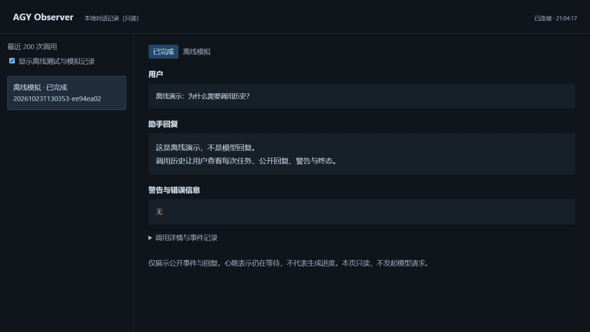

# AGY Observer MCP

一个独立、轻量的 Antigravity CLI MCP 桥接服务：**一次调用、一份流式记录、一个可见对话窗口**。

从我们对 PAL MCP Server 的本地适配工作中整理而来，独立运行不需要完整 PAL 或其他模型提供方 SDK。来源与改动说明见 [NOTICE](NOTICE) 和 [设计说明](docs/architecture.md)。目前是 `0.1.0` 预览版本，不是 Google 或 PAL 的官方产品。



## 能做什么

- MCP 发起一次 `agy` 请求，不自动重试、不自动切换模型。
- 调用前请求打开本地可见窗口，展示用户问题、公开回复、警告和真实终态。
- 流式处理 `init`、`step_update`、`result`，只展示公开回复；不展示内部思考内容。
- 历史列表和对话各自滚动；离线测试/模拟默认隐藏，不与真实对话混淆。
- 每次记录 `status.json`、`events.jsonl`、`transcript.md`，失败、取消、超时都有终态。
- CLI 最长30秒、外层最长40秒、stdout/stderr各2MiB读取时限额。
- 默认关闭模型执行；本地只读发现不会调用模型。

## 安装

需要 Python 3.10+，以及**另行安装、由用户自行登录**的官方 `agy` CLI。桌面IDE可执行文件不能代替CLI。项目不下载CLI、不自动登录、不读取或打包认证文件。

```sh
python -m venv .venv
# Linux/macOS: .venv/bin/python；Windows: .venv\Scripts\python.exe
python -m pip install .
```

请使用你创建的venv内Python执行安装，或先激活该venv。项目依赖锁定兼容范围 `mcp>=1.30,<2`，对应本次本地验证的MCP 1.x接口；不声称已经兼容2.x。

## 先做零费用验证

```sh
python -m unittest discover -s tests -v
python -m agy_observer.demo --state-dir ./state --port 8766 --open
```

测试只启动本地Python测试程序和本地MCP/HTTP服务，不启动真实CLI，不访问模型服务。演示URL带 `?tests=1`，明确显示“离线模拟”，按Ctrl+C退出。只有 `agy_run` 且执行开关明确为1时才可能调用模型。

## MCP连接

将客户端指向venv内Python，参数为 `-m agy_observer.server`。示例见 [通用MCP JSON](examples/mcp.json) 和 [Codex TOML](examples/codex-config.toml)。配置示例中的路径需要替换为你自己的绝对路径。示例始终保持执行关闭，没有凭据字段。

```json
{
  "mcpServers": {
    "agy-observer": {
      "command": "/absolute/path/to/.venv/bin/python",
      "args": ["-m", "agy_observer.server"],
      "env": {
        "AGY_OBSERVER_ENABLED": "0",
        "AGY_OBSERVER_CLI": "/absolute/path/to/agy",
        "AGY_OBSERVER_WORKSPACE": "/absolute/path/to/empty-workspace",
        "AGY_OBSERVER_STATE_DIR": "/absolute/path/to/private-state"
      }
    }
  }
}
```

确认用户授权、模型费用与工作目录后，操作方才能将 `AGY_OBSERVER_ENABLED` 改为 `1`。本项目不会代替客户端管理用户审批。默认模型名是 `gemini-3.8-flash-low`，只是已测试的请求标签，不代表任何账号都拥有权限、余额或相同模型目录。

### MCP工具

| 工具 | 作用 | 是否启动模型 |
| --- | --- | --- |
| `agy_info()` | 版本、执行开关、请求模型、超时/输出限额 | 否 |
| `agy_history(limit=20, include_tests=false)` | 当前实例存储的历史 | 否 |
| `agy_status(run_id)` | 某次任务的实时/终态 | 否 |
| `agy_run(prompt)` | 固定配置模型的单次请求 | 执行开关为1时，是 |
| `agy_cancel(run_id)` | 取消本实例拥有的活动任务 | 否 |

仅允许单个活动模型调用，避免意外并发费用。当前版本不提供文件/图像上传、任意CLI参数、自动恢复会话、多轮stdin会话或HTTP执行端点。历史是逐次调用的集合；不会把不同run拼装成同一个模型会话。

### 配置变量

| 变量 | 默认值/含义 |
| --- | --- |
| `AGY_OBSERVER_ENABLED` | `0`；只有精确的`1`启用执行 |
| `AGY_OBSERVER_CLI` | `agy`，也可以是CLI绝对路径 |
| `AGY_OBSERVER_MODEL` | `gemini-3.8-flash-low` |
| `AGY_OBSERVER_WORKSPACE` | 无默认；执行时必须指向现有目录，建议空目录 |
| `AGY_OBSERVER_STATE_DIR` | Linux/macOS按XDG state路径；Windows按LOCALAPPDATA |
| `AGY_OBSERVER_PORT` | `0`，由操作系统选择空闲loopback端口 |
| `AGY_OBSERVER_OPEN_BROWSER` | `1`；设为`0`是明确选择无界面运行 |
| `AGY_OBSERVER_CLI_HOME` | 可选，指向**已有**CLI登录HOME；不迁移或复制 |
| `AGY_OBSERVER_CLI_XDG_CONFIG_HOME` 等 | 可选，CONFIG/CACHE/DATA/STATE各自指向已有CLI路径 |

CLI子进程只继承常见系统/用户会话环境及上述明确路径，不透传API密钥类环境变量。凭据由官方CLI按照其正常机制使用，桥接服务自身不读凭据内容。

## Windows与WSL

CLI和本MCP最好运行在同一个操作系统环境。若CLI在WSL中，将Python包安装在该WSL用户的venv中，客户端使用 `wsl.exe -d <发行版> -u <非root用户> --exec <venv-python> -m agy_observer.server`。不要以默认root启动模型。

WSL的窗口打开会尝试系统浏览器，再尝试Windows PowerShell的普通 `Start-Process`；不传ExecutionPolicy或权限绕过参数。浏览器访问WSL loopback依赖WSL的localhost转发。原先本地实验采用Windows托管页面；这个独立版的WSL页面转发和真实CLI尚未重新做付费验收，不能将旧实现的通过范围无限外推。如果无图形环境，可明确选择 `AGY_OBSERVER_OPEN_BROWSER=0` 并从 `agy_info` 获取URL。没有额外认证HOME隔离层。

## 已验证与未验证

提取前的本地原型曾完成直接CLI流式、PAL完整链路及自然语言对话测试，公开schema为 init/ACTIVE回复/DONE/result。该历史事实不等于独立包已经重新完成真实模型端到端验证。

独立包发布准备只做零费用测试：标准输入输出MCP握手/工具发现、禁用执行门禁、合成输出、目录遍历/Host检查、双流上限、超时和取消父子进程。测试结果见 [验证范围](docs/validation.md)，真实私有对话回执没有放进仓库。

`--mode plan --sandbox` 与提示词**不是已验证的强制只读保证**。CLI仍可能具备工具能力，`agy_run`明确标记为可能产生外部副作用。只显示CLI公开事件，不承诺独立审计了所有操作；请求模型名也不构成服务端身份认证。

Linux清理本次进程组，不能保证主动`setsid`脱离的daemon；Windows的PID树终止也不保证父进程已退出后的所有后代，尚未实现Job Object。详细边界见 [安全与隐私](SECURITY.md)。

参考：[官方headless事件格式](https://antigravity.google/docs/cli/headless/)、[MCP Python SDK](https://github.com/modelcontextprotocol/python-sdk)。

## 发布与隐私

只发布源码、文档、离线测试和配置模板。**不要上传state、runs、登录HOME、CLI二进制、venv、真实对话或本地安装回执。** 历史会以明文保存用户提示与公开回复，是操作方的私有数据；`.gitignore`不是自动脱敏工具。页面只绑定127.0.0.1，不应作为公网服务运行。

许可证：Apache-2.0，保留来源说明；不是PAL、Google或OpenAI的官方分发。
