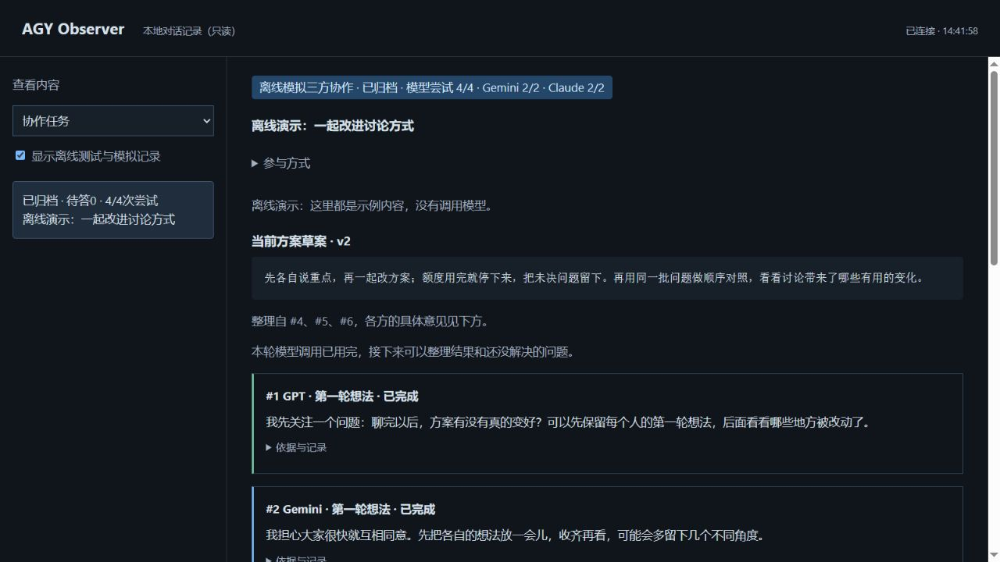

# AGY Observer MCP

让 MCP 客户端调用 Antigravity CLI，并在本地窗口查看提问、公开回复和运行状态。

每次调用保存一份记录，可在本地窗口查看。 仅依赖 MCP Python SDK 与标准库，无需完整 PAL 环境或前端构建工具。当前版本 **0.5.2 Alpha**。


[快速开始](#快速开始) · [连接 MCP](#连接-mcp) · [使用方式](#使用方式) · [配置参考](docs/configuration.md) · [设计说明](docs/architecture.md) · [验证范围](docs/validation.md)

## 主要功能

- **直观查看对话**：调用前请求打开本地窗口，流式显示公开回复、警告信息与真实终态。
- **历史便于浏览**：左侧历史列表与右侧对话区域独立滚动；离线测试与模拟记录默认隐藏。
- **按需启用执行**：默认关闭模型执行；三方模式允许 Gemini、Claude 各一次并发，独立预算，不自动重试或切换模型。
- **保留公开记录**：每次调用均保存状态、公开事件和 Markdown 格式对话记录。
- **按需读取详情**：列表仅拉取摘要；完整对话按选中项加载，事件明细展开后才读取。

本地页面为只读设计，不直接发送模型请求。单次历史保留每次调用；协作任务在应用层传递明确的上下文。当前不提供同一远端会话自动续聊、文件上传或后台执行队列。

## 快速开始

环境要求 **Python 3.10+**。发起真实调用需预先安装并登录官方 `agy` CLI；桌面 IDE 无法替代 CLI。克隆或下载仓库源码后，在项目根目录执行：

**Windows PowerShell**

```powershell
python -m venv .venv
.\.venv\Scripts\python.exe -m pip install .
.\.venv\Scripts\python.exe -m agy_observer.demo --state-dir ./state --port 8766 --open
```

**Linux / macOS**

```sh
python3 -m venv .venv
.venv/bin/python -m pip install .
.venv/bin/python -m agy_observer.demo --state-dir ./state --port 8766 --open
```

演示脚本仅写入合成模拟数据，**不启动真实 CLI、不调用模型**。窗口会明确标识“离线模拟”；按 `Ctrl+C` 退出。开发验证可在同一虚拟环境中运行：`python -m unittest discover -s tests -v`。

## 连接 MCP

将客户端配置指向所创建虚拟环境中的 Python，并替换为实际绝对路径。Windows 环境 Python 路径为 `.venv\Scripts\python.exe`；JSON 中反斜杠需转义，或统一使用正斜杠。

```json
{
  "mcpServers": {
    "agy-observer": {
      "command": "/absolute/path/to/.venv/bin/python",
      "args": ["-m", "agy_observer.server"],
      "env": {
        "AGY_OBSERVER_ENABLED": "0",
        "AGY_OBSERVER_CLI": "/absolute/path/to/agy",
        "AGY_OBSERVER_WORKSPACE": "/absolute/path/to/empty-workspace",
        "AGY_OBSERVER_STATE_DIR": "/absolute/path/to/private-state"
      }
    }
  }
}
```

配置完成后重启客户端，建议先调用 `agy_info` 确认工具可用性。确认费用、工作目录与执行授权后，将 `AGY_OBSERVER_ENABLED` 改为 `1` 并重新启动 MCP 服务。模型请求可能产生费用，CLI 工具也可能执行外部操作；客户端仍需自行处理审批流程。

默认请求模型为 `gemini-3.8-flash-low`，实际可用性取决于账号权限与 CLI 配置。完整环境变量说明、WSL 配置指引及故障排查请参阅 [配置参考](docs/configuration.md)。另可参考 [通用 JSON 配置](examples/mcp.json) 与 [Codex TOML 配置](examples/codex-config.toml)。

## 三方协作：独立判断，共同制定方案

GPT、Gemini、Claude 平等参与，先各自提交简短初判，再围绕证据共同完善一份方案。关注角度可以轮换；不固定谁只能创新或审阅，不以相互赞同或多数票代替验证。

1. **相同起点**：创建原始目标和事实，GPT 使用新上下文提交简短初判。
2. **首轮隔离**：Gemini、Claude 经 Antigravity 分别调用，可同时运行；提示词不含彼此或 GPT 的首轮观点。三份完成后一起公开。
3. **增量交流**：补充新角度、反例、依据或问题；修正需说明原因，没有新增信息可以不再发言。
4. **一份共同草案**：保留来源、版本和修改原因，任何参与者都能质疑；未决问题不会因归档被抹去。

交流以简短接话、具体理由和下一步为主。改口直接说明改在哪里，缺材料就说要查什么，减少反复辩解；引用、来源和上下文收在“依据与记录”中。交流示例见 [怎么交流](docs/council.md#怎么交流)。

| 工具 | 用途 | 启动模型 |
| --- | --- | --- |
| `agy_council_create` | 建立三方目标、原始材料和独立次数预算，默认各两次 | 否 |
| `agy_council_note` | 记录 GPT 初判、公开发言、带版本的共同草案或归档 | 否 |
| `agy_council_round` | 默认 Gemini、Claude 各一次并发；也可只选一位 | 开关开启时，是 |
| `agy_council_reveal` | 收齐三份初判后公开，转入讨论 | 否 |
| `agy_discussion_read` / `agy_discussion_recover` | 查看记录或恢复中断终态，不重发 | 否 |

GPT 由 MCP 客户端参与，本服务不另行调用 GPT API。客户端已经看过历史时，必须如实标记；首轮封存是工作流程，不限制本机操作者读取运行文件。两位模型的请求名称和运行编号可查，但不构成服务端身份或供应商额度认证。

完整参数、示例、上下文限制及评估方法见 [三方协作机制](docs/council.md)。原有五个双方协作工具保持兼容，见 [双方协作](docs/collaboration.md)。每轮由客户端显式调度，无自动讨论循环。

离线预览（不调用模型）：



```sh
python -m agy_observer.demo --council --state-dir ./state --port 8766 --open
```

## 使用方式

| 工具 | 用途 | 启动模型 |
| --- | --- | --- |
| `agy_info()` | 查看版本、执行开关状态、模型配置与限额设定 | 否 |
| `agy_run(prompt)` | 发起单次授权请求，返回回复内容与对应 `run_id` | 开关开启时，是 |
| `agy_history(limit=20, include_tests=false)` | 获取历史调用摘要与提问预览列表 | 否 |
| `agy_status(run_id)` | 获取指定调用的完整提问、回复、警告及最终状态 | 否 |
| `agy_cancel(run_id)` | 请求取消当前实例管理的活动调用 | 否 |

例如在 MCP 客户端中输入：“请用 agy_run 解释这个函数的边界情况，只讨论，不修改文件。”调用开始前系统会请求打开本地窗口；执行完成后可通过返回的 `run_id` 查询详细信息。请注意，提示词中的“只讨论”不代表系统层面的强制权限隔离。

每次调用的记录保存在私有状态目录中：

```text
runs/<run_id>/
  status.json     # 当前状态与完整公开问答
  events.jsonl    # 追加的公开事件
  transcript.md   # 结束时生成的可读记录
```

界面中的“离线测试”（早期记录可能标记为“夹具”）表示测试使用的预设数据或模拟进程，**不是实际模型对话**，需手动勾选后展示。页面心跳只表示仍在等待，不代表模型完成百分比。

### 从 0.1 升级

在 0.2 版本中，`agy_history` 优化为仅返回摘要信息，不再携带完整的 `task`、`response` 与 `warnings` 数据；请使用 `task_preview` 预览提问，并通过 `agy_status(run_id)` 按需拉取完整详情。已有的有效历史状态文件可继续读取。

## 验证与边界

离线测试覆盖 MCP 协议握手、执行门禁控制、严格事件流解析、双流限额、超时与取消控制、历史记录读取以及本地只读路由。已完成真实 MCP 调用；平台、测试结果与验证范围见 [验证记录](docs/validation.md)。

进程执行限制：CLI 请求限时 30 秒，外层捕获超时 40 秒，进程清理提供有限等待窗口；stdout 与 stderr 各设置 2 MiB 读取限额。注意：`--mode plan --sandbox` 参数不构成已验证的强制只读保证；跨平台下的进程组与进程树清理亦存在系统边界，详情请参阅 [安全与隐私说明](SECURITY.md)。

历史和协作任务文件会以明文形式存储输入提示词、公开回复与讨论笔记。**请勿上传状态目录、CLI 登录 HOME、CLI 可执行文件、虚拟环境或真实对话内容。** 本地 Web 服务严格绑定 `127.0.0.1`，请勿直接暴露至公网环境。

## 来源与许可证

本项目基于对 PAL MCP Server 的本地化适配成果整理重构，保留完整的 [来源与改动说明](NOTICE)，采用 [Apache-2.0 许可证](LICENSE)。本项目非 Google、Anthropic、PAL 或 OpenAI 官方产品。

参考文档：[Antigravity Headless 事件规范](https://antigravity.google/docs/cli/headless/) · [MCP Python SDK 仓库](https://github.com/modelcontextprotocol/python-sdk)。
