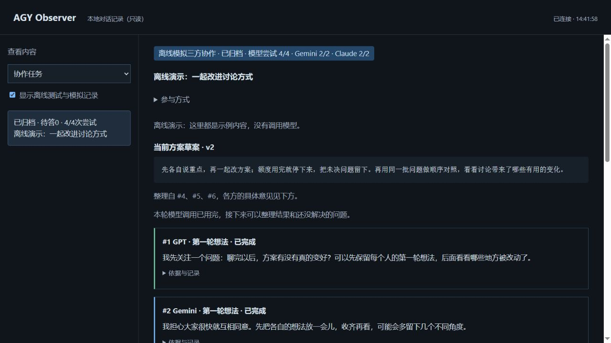

# AGY Observer MCP

**在 MCP 客户端里接入 Gemini、Claude 和独立 Codex CLI，让模型一起讨论项目，并在本地窗口看清每次调用和方案的演变。**

AGY Observer MCP 支持 Antigravity、官方 Claude Code 和 Codex CLI 三个调用渠道，使用各 CLI 自己的登录。你可以只问一个问题，也可以让当前客户端中的 GPT 与 Gemini、Claude 共同理解项目、选择分工、追问和修改一份方案。提问、回答、讨论依据和方案版本留在本机，方便回看和继续推进。

**当前版本：0.8.0** · [版本记录](CHANGELOG.md) · Apache-2.0

[调用渠道](#调用渠道) · [功能与场景](#功能与场景) · [工作方式](#工作方式) · [安装与演示](#安装与演示) · [连接 MCP](#连接-mcp) · [第一次使用](#第一次使用) · [三方协作](#三方协作怎样开展) · [常见问题](#常见问题) · [文档导航](#文档导航)

## 调用渠道

| 参与者 | 渠道 | 请求模型与来源 |
| --- | --- | --- |
| GPT（客户端） | 当前 MCP 客户端 | 客户端提交自己的发言，不伪装成 CLI 返回 |
| Gemini | Antigravity | 保留原有 agy 调用 |
| Claude | Antigravity 或官方 Claude Code | 显式选择渠道与该账号可用的 Opus；无 Sonnet 回退 |
| Codex CLI | 独立 Codex CLI | 单独配置请求模型，独立运行编号，与客户端 GPT 分开显示 |

参与者、渠道、模型分开配置。默认问答与三方任务仍沿用 Antigravity；可以只邀请需要的参与者，也可以创建包含独立 Codex 的2–4人任务。所有渠道共用项目理解、动态角色提示词、共同草案版本、窗口和历史。

安装各 CLI、选择路由、单次调用、多方讨论及安全默认值见[多渠道接入指南](docs/channels.md)。CLI 与 MCP 应在同一系统环境中运行；缺少某个 CLI、登录或模型权限会明确失败，不擅自切换或重试。0.8.0 的验证以离线模拟和真实 MCP 握手为主，未新增付费推理请求。

## 功能与场景

调用另一个模型后，结果在哪里、为什么还在等待、上次建议为什么被修改，往往比发出请求更难追踪。本项目把调用过程和项目讨论放到一个可回看的本地窗口中。

| 你想做什么 | 如何使用 | 能看到什么 |
| --- | --- | --- |
| 给某段代码补一轮检查 | 从 MCP 客户端发起一次模型请求 | 逐步输出的公开回复、最终状态和完整问答 |
| 共同梳理一个项目 | 让 GPT、Gemini、Claude 先看相同的项目简报，再按缺口分工 | 三方初判、角色提示词、问题与回应、共同方案版本 |
| 回看某个决定的来由 | 在历史或讨论时间线中查看相关记录 | 原始提问、关联回复、修改原因和仍待核实的问题 |
| 先看看工具是否适合自己 | 启动离线演示 | 有明确模拟标识的界面，不产生模型请求 |

适合代码评审、需求梳理、设计方案讨论和阶段复盘。简单问题可以直接单次调用；涉及多个约束或需要相互追问时，再创建协作任务。

### 本地窗口里有什么

- **调用与状态**：公开回复随事件逐步显示，等待、完成、失败和取消都有状态可查。
- **完整问答与历史**：左侧历史列表与右侧正文独立滚动，可以按调用编号回查详情。
- **讨论时间线**：直接使用 GPT、Gemini、Claude 名称，查看谁提出问题、谁作了回应，以及引用的依据。
- **分工和共同草案**：查看当前角色提示词、过去的分工版本、方案修改和未解决的问题。


## 工作方式

```text
你在 MCP 客户端提出问题或推进项目
                  │
          AGY Observer MCP
            ├─ Antigravity CLI ─ Gemini / Claude Opus
            ├─ Claude Code CLI ─ Claude Opus
            ├─ Codex CLI ─ 独立 Codex 参与者
            └─ 本地记录与只读窗口

GPT 的发言来自当前 MCP 客户端，客户端组织每一轮交流。
```

| 组成 | 负责什么 |
| --- | --- |
| MCP 客户端中的 GPT | 阅读项目材料，提交自己的看法，组织话轮，汇集共同草案并执行获授权的项目工作 |
| Gemini、Claude 与独立 Codex | 通过所选 CLI 渠道参与理解、提问、补充和修正；每场任务按需要选择 |
| MCP 服务 | 调用 CLI，记录状态与问答，管理尝试预算、分工和方案版本 |
| 本地网页 | 展示调用和讨论；提问、继续讨论及修改操作从 MCP 客户端发起 |

GPT 由客户端参与，本服务不另行调用 GPT API。Gemini 与 Claude 可以在同一个显式批次中并发请求，各有自己的本地尝试次数；服务商的实际额度与权限仍由各自账号决定。

项目采用 Python、MCP SDK 和标准库实现，无需构建前端。发起真实调用需要 **Python 3.10+**，以及已安装、已登录的官方 **所选渠道的 CLI**。默认 Antigravity 需官方 `agy` CLI，桌面 IDE 不能替代它；直接通道的安装见[多渠道接入](docs/channels.md)。

## 安装与演示

### 1. 安装项目

克隆或下载仓库源码，在项目根目录创建虚拟环境并安装。

**Windows PowerShell**

```powershell
python -m venv .venv
.\.venv\Scripts\python.exe -m pip install .
```

**Linux**

```sh
python3 -m venv .venv
.venv/bin/python -m pip install .
```

也可以从本仓库 **Releases → v0.8.0 → Assets** 下载 wheel，在下载目录中把上面的安装命令替换为：

```sh
python -m pip install ./agy_observer_mcp-0.8.0-py3-none-any.whl
```

此处 `python` 应替换为刚创建的虚拟环境 Python 路径。发布附件同时提供 `SHA256SUMS`，可核对下载文件。当前文档以 Windows/Linux 为已验证环境，macOS 尚未完成验证。

### 2. 先运行离线演示

**Windows PowerShell**

```powershell
.\.venv\Scripts\python.exe -m agy_observer.demo --state-dir ./state --port 8766 --open
```

**Linux**

```sh
.venv/bin/python -m agy_observer.demo --state-dir ./state --port 8766 --open
```

打开 `http://127.0.0.1:8766/` 即可查看。演示只写入合成数据，不需要 CLI 登录，也不调用模型；页面会标识“离线模拟”。按 `Ctrl+C` 停止演示服务。

三方讨论界面的离线演示可加 `--council`：

```sh
python -m agy_observer.demo --council --state-dir ./state --port 8766 --open
```

同样使用虚拟环境中的 Python。截图和演示用于说明界面，真实模型验证另见[验证记录](docs/validation.md)。

## 连接 MCP

### 1. 准备 CLI 和目录

在准备运行 MCP 的同一环境中安装并登录官方 `agy` CLI，用 `agy models` 查看账号可用模型。建立一个工作目录和一个私有状态目录，配置时使用绝对路径。

- **工作目录**：CLI 启动时所在位置。初次测试可使用空目录；需要讨论的材料由客户端明确提供。
- **私有状态目录**：保存调用问答与讨论文件。建议放在发布仓库之外，使用本机磁盘。

### 2. 添加客户端配置

以下是通用 MCP JSON 配置。替换 Python、CLI、工作目录和状态目录的路径；Windows Python 通常位于 `.venv\Scripts\python.exe`，JSON 路径可以统一使用正斜杠。

```json
{
  "mcpServers": {
    "agy-observer": {
      "command": "/absolute/path/to/.venv/bin/python",
      "args": ["-m", "agy_observer.server"],
      "env": {
        "AGY_OBSERVER_ENABLED": "0",
        "AGY_OBSERVER_CLI": "/absolute/path/to/agy",
        "AGY_OBSERVER_WORKSPACE": "/absolute/path/to/empty-workspace",
        "AGY_OBSERVER_STATE_DIR": "/absolute/path/to/private-state"
      }
    }
  }
}
```

重启客户端后，先调用 `agy_info` 查看版本、执行开关、模型与限额。准备好发起真实请求时，将 `AGY_OBSERVER_ENABLED` 改为 `1`，再重启 MCP 服务。模型调用可能产生费用；客户端应按项目授权处理 CLI 操作。

### 3. 选择模型与等待时间

| 环境变量 | 用途 | 配置建议 |
| --- | --- | --- |
| `AGY_OBSERVER_MODEL` | 单次调用及三方任务的 Gemini 请求模型 | 默认 `gemini-3.8-flash-low`，以 `agy models` 的实际结果为准 |
| `AGY_OBSERVER_CLAUDE_MODEL` | 三方任务的 Claude 请求模型 | 默认 `claude-opus-4-6-thinking`；官方 Claude Code 使用该账号可用的 Opus 标识，如 `opus` |
| `AGY_OBSERVER_CLI_TIMEOUT` | 单次 CLI 请求的等待上限 | 默认 30 秒；慢模型可设 120 秒，最高 180 秒 |
| `AGY_OBSERVER_OUTER_TIMEOUT` | 外层捕获的等待上限 | 默认 `max(40, CLI超时+10)` 秒；慢模型可设 150 秒，最高 210 秒 |
| `AGY_OBSERVER_OPEN_BROWSER` | 是否请求自动打开本地窗口 | 默认 `1`；无桌面环境可显式设为 `0` |

模型标识随账号和 CLI 而异，不能只改页面显示名称。客户端自己的工具等待时间也需要覆盖外层超时与清理时间；仓库中的 Codex 示例设为 240 秒。

可直接参考[通用 JSON](examples/mcp.json)或[Codex TOML](examples/codex-config.toml)。完整变量、Windows/WSL 环境和登录排查见[配置参考](docs/configuration.md)。

## 第一次使用

下面是可发送给 MCP 客户端的使用指令示例，不是模型对话记录。客户端是否能自动完成整套流程，取决于它的工具调用能力。

### 先完成一次真实问答

> 先调用 agy_info 检查配置。执行已开启时，用 agy_run 请模型检查下面这段函数的边界情况，并给出可验证的例子。只讨论，不修改文件。请把调用编号和最终状态告诉我。
>
> ［在这里粘贴要检查的函数］

调用时本地窗口显示逐步输出的回复。结束后，客户端返回结果与 `run_id`；通过 `agy_status(run_id)` 可以查看完整详情，`agy_history` 用于查找旧调用。“只讨论”是任务要求，CLI 权限边界见[安全说明](SECURITY.md)。

### 再推进一场项目讨论

> 请先阅读这个项目相关的 README、实现和测试，整理目标、当前阶段、成功标准、约束及材料缺口。
> 创建 GPT、Gemini、Claude 的三方任务，Gemini 和 Claude 各最多尝试 3 次。
> 先让三方各自提出简短理解，再根据发现选择当前最需要的三个角色并生成提示词。
> 围绕同一份草案接话、追问和修正；需要核实的内容安排具体检查，没有新信息就停止。
> 最后给我执行步骤、验收条件和未解决的问题，并保留讨论过程。

这类任务通常留下项目简报、三份初判、分工提示词、讨论时间线和带版本的方案。它们用于推进工作；代码是否完成、测试是否通过，仍以实际执行结果为准。

## 三方协作怎样开展

默认仍为客户端 GPT、Gemini、Claude。也可按[多渠道指南](docs/channels.md)选择包含独立 Codex 的2–4位参与者；只调用当前任务需要的渠道。

### 先理解项目，再决定分工

一个新项目可能需要需求、实现和测试三个角度；另一个项目可能更需要交互、兼容性和发布维护。角色来自项目当前的缺口，GPT、Gemini、Claude 都可以跨角色补充或质疑。

1. **整理材料**：客户端读取相关文档和代码，填写阶段、材料来源与内容、成功标准、约束和未知项。MCP 不会自行扫描整个仓库。
2. **分别初判**：三方先针对相同原始材料提出简短理解和遗漏。Gemini、Claude 首轮看不到其他人的发言；GPT 的上下文由客户端如实标记。
3. **一起公开并选角**：收齐所选参与者的成功初判后公开，再选择对应数量的互补角色，说明职责、预期产出和选择原因，生成各自提示词。
4. **共同推进一份草案**：参与者围绕具体问题补证、提问、举反例或修正。客户端汇集带版本的方案，后续修改保留原版本与原因。
5. **按阶段调整或结束**：主要问题变化时更新分工；信息不足、预算用完或没有新内容时，记录阶段结果和待办。

独立初判只需指出关键理解与缺口，随后再共同制定方案。这样的输入安排可以减少首个观点直接进入其他人的初判，但讨论质量仍需要检查，不能把“都赞同”当作验证。

### 怎样做到互相接话

讨论可以由任何参与者提出问题或替代想法。后续回复应回应已有问题、说明理由，并指出下一步；改变判断时记录依据，没有新增内容可以 `pass`。

并发批次中的 Gemini、Claude 看到同一份调用前快照。要让其中一位回应另一位刚返回的意见，需要再显式安排一个后续话轮。也可以只邀请一位继续，不要求每轮全员发言。

分工和方案都有版本，切换阶段不会覆盖旧提示词或重置预算。默认 Gemini、Claude 各有 2 次尝试，可在创建任务时设为各 1–8 次；预留后的失败、超时和取消同样计次。每轮由客户端明确发起，服务没有自动讨论循环、自动重试或模型降级。



完整参数及示例见[项目理解与动态分工](docs/project-workflow.md)和[三方协作机制](docs/council.md)。后者也说明初判封存、引用、上下文截断和评估办法。GPT 来源标签和首轮封存属于协作流程，不是模型身份认证或本机文件访问控制。

## MCP 工具一览

共 15 个工具，按需使用即可。创建任务、记录笔记、读取历史和恢复记录均不发起模型请求。

| 场景 | 工具 | 用途 |
| --- | --- | --- |
| 检查配置 | `agy_info` | 查看版本、开关、模型和限额 |
| 单次问答 | `agy_run` | 发起一次请求，可指定 participant、channel、model |
| 查历史与状态 | `agy_history`、`agy_status` | 列出摘要，或读取某次完整问答和终态 |
| 取消调用 | `agy_cancel` | 请求取消本实例管理的活动调用 |
| 建立三方任务 | `agy_council_create` | 保存目标、材料和各自尝试预算 |
| 记录与公开 | `agy_council_note`、`agy_council_reveal` | 记录 GPT 发言、共同方案或总结，收齐后公开初判 |
| 项目分工 | `agy_council_assign_roles` | 生成角色提示词，按阶段追加分工版本 |
| 三方话轮 | `agy_council_round` | 向 Gemini、Claude 中的一位或两位发起请求 |
| 读取与恢复讨论 | `agy_discussion_read`、`agy_discussion_recover` | 查看任务，或核对关联运行并恢复终态；不重发请求 |
| 双方协作 | `agy_discussion_create`、`agy_discussion_note`、`agy_discussion_turn` | 创建双方任务、记录客户端发言、向配置模型交接话轮 |

双方协作保留兼容，适合只需要一位远端模型的交流，详见[双方协作](docs/collaboration.md)。精确参数以客户端发现的工具说明及相应文档为准。

## 记录、费用与隐私

每次调用的记录保存在配置的私有状态目录中：

```text
<state>/
  runs/<run_id>/
    status.json      # 当前状态与完整公开问答
    events.jsonl     # 追加的公开事件
    transcript.md    # 结束时生成的可读记录
  discussions/
    <id>.json        # 项目简报、分工、发言和方案版本
```

这些文件以明文保存你提供的材料、模型公开回复和讨论笔记，记录留在本机。请求模型时，相应提示词和本轮带入的上下文仍会通过 CLI 发送给模型服务商；本地保存不等于离线推理。

公开仓库和发布附件包含代码、文档、测试及合成演示，不附带维护者的真实对话、私有状态目录或 CLI 登录资料。使用时也应把自己的状态目录、登录 HOME、密钥和虚拟环境留在仓库之外。Git 提交作者信息属于公开元数据。

执行默认关闭。启用后的请求受超时和输出上限约束，协作任务另有本地尝试预算；预算用于控制本服务的尝试次数，不读取或保证供应商余额。CLI 的 `--mode plan --sandbox` 参数与角色提示词都不能替代已验证的权限隔离。HTTP 页面严格绑定 `127.0.0.1`，仅供本机只读查看。完整边界见[安全与隐私说明](SECURITY.md)。

## 升级与异常恢复

升级前先停止使用该状态目录的旧 MCP 实例，备份私有状态，再用目标版本的 wheel 或源码安装；避免新旧版本同时写同一个目录。

如果原始调用成功，但讨论内容保存失败，可调用 `agy_discussion_recover` 核对任务、消息和模型关联后恢复。它保留失败审计，不重新调用模型，也不会把真实失败改成成功。

遇到写锁提示、状态文件损坏或旧格式数据，先保留原始文件并按[升级与异常恢复](docs/configuration.md#升级与异常恢复)检查。当前协议的崩溃残留可在取得操作系统锁后回收；未知旧锁需要核对，不能直接删除所有锁文件。

从 0.1 升级的客户端还需注意：`agy_history` 自 0.2 起返回摘要与 `task_preview`，完整 `task`、`response`、`warnings` 改由 `agy_status(run_id)` 按需读取。

## 常见问题

**为什么本地页面打不开，原来的讨论不见了？**

页面由本地进程提供，停止演示、退出 MCP 客户端或服务关闭后，原端口可能不再可用。重新启动使用同一状态目录的服务，并使用新返回的本地地址；默认端口可由系统分配。讨论文件和页面服务分开保存，页面关闭本身不会删除历史。

**为什么没有真实对话，只能看到“离线测试”或“夹具”？**

“夹具”是早期对预设测试数据的称呼。离线演示不请求模型，测试记录需手动勾选展示。真实问答需要 CLI 已登录、执行开关为 `1`，并从客户端实际调用 `agy_run` 或协作话轮工具。

**网页可以直接输入问题吗？**

当前页面用于查看。问题、话轮和方案修改从 MCP 客户端发起；网页不提供执行或写入接口。

**能同时调用 Gemini 和 Claude 吗？会一直聊下去吗？**

三方任务可以在一个显式批次中各调用一次。同一实例最多并发两个不同的配置模型，同一模型不能重叠运行；下一轮需要客户端明确调度，预算耗尽后停止发起新尝试。

**慢模型经常超时怎么办？**

根据任务配置有上限的等待时间，例如 CLI 120 秒、外层 150 秒，同时提高客户端工具等待时间。页面心跳只表示仍在等待，不是完成百分比。失败保留原记录；服务不会自行重试。

**三方一起讨论一定更好吗？**

效果取决于材料、问题和实际验证。项目提供独立初判、引用、反问、角色调整和方案版本，帮助找出具体分歧；是否改善结果，需要在相同任务和调用预算下比较。已完成的链路验证不等于质量优越性证明。

## 验证与支持范围

v0.7.1 完成 97 项离线回归：本地 Windows 96 项通过、1 项因符号链接权限跳过，WSL 97 项通过；正式发布对应的 Windows/Linux × Python 3.10/3.12 四组 CI 通过。另验证 wheel 构建、干净安装与 15 工具的 MCP 握手，候选阶段完成 Gemini、Claude Opus 的真实协作流程。

测试覆盖协议握手、执行开关、事件流、超时与取消、历史读取、并发预算、方案版本、恢复和本地只读路由。开发者可在安装依赖的虚拟环境中运行：

```sh
python -m unittest discover -s tests -v
```

当前正式版面向已验证的 Windows/Linux 本地 CLI 工作流。macOS、网络文件系统与所有供应商负载条件尚未验证；进程组/进程树清理存在系统边界，stdout 与 stderr 各有 2 MiB 读取限额。具体过程、历史版本和失败记录说明见[验证记录](docs/validation.md)。

## 文档导航

| 文档 | 阅读内容 |
| --- | --- |
| [多渠道接入](docs/channels.md) | 参与者、Antigravity/Claude Code/Codex渠道、模型及使用示例 |
| [配置参考](docs/configuration.md) | 环境变量、模型选择、WSL、等待时间、升级和故障排查 |
| [项目理解与动态分工](docs/project-workflow.md) | 项目简报、选角、角色提示词与阶段切换的完整示例 |
| [三方协作机制](docs/council.md) | 三方工具参数、初判、引用、共同草案、上下文与预算 |
| [双方协作](docs/collaboration.md) | 一位远端模型参与时的提问、回应和话轮交接 |
| [设计说明](docs/architecture.md) | 代码结构、职责边界与数据流 |
| [验证记录](docs/validation.md) | 离线测试、真实调用与适用范围 |
| [安全与隐私](SECURITY.md) | 本地数据、执行权限、HTTP 与进程边界 |
| [版本记录](CHANGELOG.md) | 各版本变化 |

## 来源与许可证

本项目由对 PAL MCP Server 的本地化适配成果整理重构而来，保留[来源与改动说明](NOTICE)，采用 [Apache-2.0 许可证](LICENSE)。本项目非 Google、Anthropic、PAL 或 OpenAI 官方产品。

参考：[Antigravity Headless 事件规范](https://antigravity.google/docs/cli/headless/) · [MCP Python SDK](https://github.com/modelcontextprotocol/python-sdk)。
