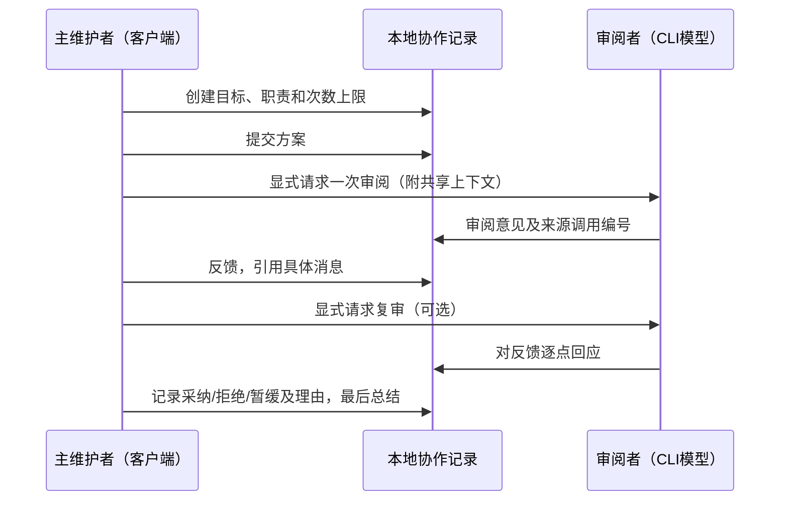

# AGY Observer MCP

让 MCP 客户端调用 Antigravity CLI，并在本地窗口查看提问、公开回复和运行状态。

每次调用保存一份记录，可在本地窗口查看。 仅依赖 MCP Python SDK 与标准库，无需完整 PAL 环境或前端构建工具。当前版本 **0.3.0 Alpha**。


[快速开始](#快速开始) · [连接 MCP](#连接-mcp) · [使用方式](#使用方式) · [配置参考](docs/configuration.md) · [设计说明](docs/architecture.md) · [验证范围](docs/validation.md)

## 主要功能

- **直观查看对话**：调用前请求打开本地窗口，流式显示公开回复、警告信息与真实终态。
- **历史便于浏览**：左侧历史列表与右侧对话区域独立滚动；离线测试与模拟记录默认隐藏。
- **按需启用执行**：默认关闭模型执行；同一时间只允许一个模型调用，不自动重试或切换模型。
- **保留公开记录**：每次调用均保存状态、公开事件和 Markdown 格式对话记录。
- **按需读取详情**：列表仅拉取摘要；完整对话按选中项加载，事件明细展开后才读取。

本地页面为只读设计，不直接发送模型请求。单次历史保留每次调用；协作任务在应用层传递明确的上下文。当前不提供同一远端会话自动续聊、文件上传或后台执行队列。

## 快速开始

环境要求 **Python 3.10+**。发起真实调用需预先安装并登录官方 `agy` CLI；桌面 IDE 无法替代 CLI。克隆或下载仓库源码后，在项目根目录执行：

**Windows PowerShell**

```powershell
python -m venv .venv
.\.venv\Scripts\python.exe -m pip install .
.\.venv\Scripts\python.exe -m agy_observer.demo --state-dir ./state --port 8766 --open
```

**Linux / macOS**

```sh
python3 -m venv .venv
.venv/bin/python -m pip install .
.venv/bin/python -m agy_observer.demo --state-dir ./state --port 8766 --open
```

演示脚本仅写入合成模拟数据，**不启动真实 CLI、不调用模型**。窗口会明确标识“离线模拟”；按 `Ctrl+C` 退出。开发验证可在同一虚拟环境中运行：`python -m unittest discover -s tests -v`。

## 连接 MCP

将客户端配置指向所创建虚拟环境中的 Python，并替换为实际绝对路径。Windows 环境 Python 路径为 `.venv\Scripts\python.exe`；JSON 中反斜杠需转义，或统一使用正斜杠。

```json
{
  "mcpServers": {
    "agy-observer": {
      "command": "/absolute/path/to/.venv/bin/python",
      "args": ["-m", "agy_observer.server"],
      "env": {
        "AGY_OBSERVER_ENABLED": "0",
        "AGY_OBSERVER_CLI": "/absolute/path/to/agy",
        "AGY_OBSERVER_WORKSPACE": "/absolute/path/to/empty-workspace",
        "AGY_OBSERVER_STATE_DIR": "/absolute/path/to/private-state"
      }
    }
  }
}
```

配置完成后重启客户端，建议先调用 `agy_info` 确认工具可用性。确认费用、工作目录与执行授权后，将 `AGY_OBSERVER_ENABLED` 改为 `1` 并重新启动 MCP 服务。模型请求可能产生费用，CLI 工具也可能执行外部操作；客户端仍需自行处理审批流程。

默认请求模型为 `gemini-3.8-flash-low`，实际可用性取决于账号权限与 CLI 配置。完整环境变量说明、WSL 配置指引及故障排查请参阅 [配置参考](docs/configuration.md)。另可参考 [通用 JSON 配置](examples/mcp.json) 与 [Codex TOML 配置](examples/codex-config.toml)。

## 协作任务：从问答到审阅闭环

0.3 新增两方协作流程。主维护者由 MCP 客户端承担，负责方案、实现、测试与最终取舍；审阅者通过配置的 CLI 模型工作，负责检查问题、回应反馈并说明证据不足之处。职责可以在创建任务时调整。



| 工具 | 作用 | 启动模型 |
| --- | --- | --- |
| `agy_discussion_create(goal, lead_brief, reviewer_brief, max_model_turns=4)` | 创建目标、分工及1–8次尝试上限；两个职责字段有默认值 | 否 |
| `agy_discussion_note(discussion_id, content, kind, reply_to, resolution)` | 主维护者提交方案、反馈、决定或总结 | 否 |
| `agy_discussion_turn(discussion_id, instruction, reply_to)` | 带入共享上下文，显式请求一次审阅 | 开关开启时，是 |
| `agy_discussion_read(discussion_id)` | 省略编号时列任务摘要；指定编号查看职责、消息、决定和调用 | 否 |
| `agy_discussion_recover(discussion_id)` | 将中断记录与已有调用终态对齐；不重新请求模型 | 否 |

最小流程：

1. `agy_discussion_create(goal="审阅历史缓存方案", max_model_turns=2)`，保存返回的 `discussion_id`。
2. `agy_discussion_note(discussion_id, content="方案及待审阅材料……", kind="proposal")`。
3. `agy_discussion_turn(discussion_id, instruction="指出缺陷、证据和建议", reply_to=1)`，这是一次模型调用。
4. 提交 `kind="feedback"`，以 `reply_to` 引用审阅消息；按需再显式请求一次复审。
5. 提交 `kind="decision"` 时必须引用已有消息，提供理由及 `resolution="accepted" / "rejected" / "deferred"`。
6. 提交 `kind="summary"` 关闭任务；总结和完成判断由主维护者负责。

页面切换“协作任务”后可查看双方时间线、分工与次数。客户端提交的身份未经验证；不会把人工笔记伪装成模型回复。模型状态中的成功只代表该次调用成功，不代表方案已获认可或代码已验证。

每次审阅使用新 CLI 调用，通过应用层共享上下文延续讨论。优先保留指定引用和最近决定，再带入近期消息；被截断、省略的编号会列在“本轮共享上下文”中。失败和取消同样占用尝试次数，不自动重试、加额度或继续下一轮。更多边界见 [协作机制](docs/collaboration.md)。


离线演示（虚拟环境内运行，不调用模型）：

```sh
python -m agy_observer.demo --collaboration --state-dir ./state --port 8766 --open
```

## 使用方式

| 工具 | 用途 | 启动模型 |
| --- | --- | --- |
| `agy_info()` | 查看版本、执行开关状态、模型配置与限额设定 | 否 |
| `agy_run(prompt)` | 发起单次授权请求，返回回复内容与对应 `run_id` | 开关开启时，是 |
| `agy_history(limit=20, include_tests=false)` | 获取历史调用摘要与提问预览列表 | 否 |
| `agy_status(run_id)` | 获取指定调用的完整提问、回复、警告及最终状态 | 否 |
| `agy_cancel(run_id)` | 请求取消当前实例管理的活动调用 | 否 |

例如在 MCP 客户端中输入：“请用 agy_run 解释这个函数的边界情况，只讨论，不修改文件。”调用开始前系统会请求打开本地窗口；执行完成后可通过返回的 `run_id` 查询详细信息。请注意，提示词中的“只讨论”不代表系统层面的强制权限隔离。

每次调用的记录保存在私有状态目录中：

```text
runs/<run_id>/
  status.json     # 当前状态与完整公开问答
  events.jsonl    # 追加的公开事件
  transcript.md   # 结束时生成的可读记录
```

界面中的“离线测试”（早期记录可能标记为“夹具”）表示测试使用的预设数据或模拟进程，**不是实际模型对话**，需手动勾选后展示。页面心跳只表示仍在等待，不代表模型完成百分比。

### 从 0.1 升级

在 0.2 版本中，`agy_history` 优化为仅返回摘要信息，不再携带完整的 `task`、`response` 与 `warnings` 数据；请使用 `task_preview` 预览提问，并通过 `agy_status(run_id)` 按需拉取完整详情。已有的有效历史状态文件可继续读取。

## 验证与边界

离线测试覆盖 MCP 协议握手、执行门禁控制、严格事件流解析、双流限额、超时与取消控制、历史记录读取以及本地只读路由。已完成真实 MCP 调用；平台、测试结果与验证范围见 [验证记录](docs/validation.md)。

进程执行限制：CLI 请求限时 30 秒，外层捕获超时 40 秒，进程清理提供有限等待窗口；stdout 与 stderr 各设置 2 MiB 读取限额。注意：`--mode plan --sandbox` 参数不构成已验证的强制只读保证；跨平台下的进程组与进程树清理亦存在系统边界，详情请参阅 [安全与隐私说明](SECURITY.md)。

历史和协作任务文件会以明文形式存储输入提示词、公开回复与讨论笔记。**请勿上传状态目录、CLI 登录 HOME、CLI 可执行文件、虚拟环境或真实对话内容。** 本地 Web 服务严格绑定 `127.0.0.1`，请勿直接暴露至公网环境。

## 来源与许可证

本项目基于对 PAL MCP Server 的本地化适配成果整理重构，保留完整的 [来源与改动说明](NOTICE)，采用 [Apache-2.0 许可证](LICENSE)。本项目非 Google、PAL 或 OpenAI 官方产品。

参考文档：[Antigravity Headless 事件规范](https://antigravity.google/docs/cli/headless/) · [MCP Python SDK 仓库](https://github.com/modelcontextprotocol/python-sdk)。
