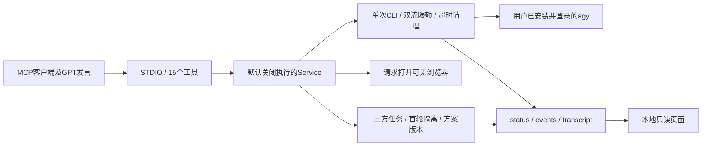

# 设计与改进范围

## 0.7.1：准入、恢复与崩溃写锁

整批准入在首次异步等待前占用，覆盖浏览器启动、次数预留与两个远端调用。内部使用私有批次标记放行，其他批次、普通调用和双方话轮在预留次数前拒绝；成功、异常、取消都释放准入。关闭服务也取消尚未注册运行的等待批次。准入占用不是次数递增：开窗前取消不占次数，已经预留的失败、取消或超时仍计次。

讨论保存失败与模型失败分别处理。恢复失败消息时核对原始运行确为 success，且任务、消息、模型三项匹配，再重新解析原始回复；记录 previous_state、previous_error、previous_finished_utc 和恢复时间，原始运行保持不变。重复恢复幂等，不调用模型。运行 success 表示 CLI 流与终态校验通过，不证明回答在语义上完整或正确；无法解析的结构化内容仍保留原文并提示。

短写事务由永久文件 `writer.guard` 上的 OS 锁保护：Windows 使用 msvcrt 字节锁，POSIX 使用 flock。文件存在不代表锁仍被持有；描述符关闭或进程退出后内核释放。`write.lock` 只是短暂的读取避让标记，包含协议、PID、唯一标识和时间，通过同目录临时文件原子发布。持有 OS 锁时才回收本协议残留并记录审计；未知旧标记不自动清理。升级要求停止旧写入实例，不支持新旧协议同时写入同一目录，未验证网络文件系统。

CLI/外层默认 30/40 秒保持不变，可显式配置到最高 180/210 秒；修改等待时间不改变任务预算，不增加自动调用。

## 模块职责

- `config.py`：显式环境配置、执行门禁、超时限额与最小CLI环境。
- `service.py`：一次模型请求映射一个进程；结果验收；三方批次可同时运行两个不同配置模型；取消所有权。
- `council.py`：三方首轮隔离、公开、独立次数预算、共享快照和带来源的方案版本；复用既有讨论文件锁与原子存储。
- `project.py`：客户端提供的项目简报、理解后选角、角色提示词生成及按阶段追加分工版本；不读取任意项目文件、不发起模型请求。
- `storage.py`：讨论与运行状态共用有限权限重试、读取避让；仅处理本地文件操作。
- `runtime.py`：并发读stdout/stderr、增量UTF-8解码、严格NDJSON、公开事件过滤、心跳与有限清理。
- `history.py`：只从配置的产物目录读取，验证run_id与链接边界。
- `monitor.py`：同一MCP进程内的loopback只读HTTP线程，随机端口，不需要全局helper/PID管理。
- `server.py`：SDK注册工具与生命周期，stdout只用于MCP协议。
- `static/index.html`：独立历史/对话滚动、真实与模拟分类、公开回复与可折叠事件。

## 相对最初PAL适配的变化

1. 从完整PAL和多提供方依赖中提取，只依赖MCP SDK与标准库。
2. 移除机器专用绝对路径、发行版、用户名、登录HOME、全局配置写入及旧安装脚本。
3. 窗口、记录与运行器共享同一次请求，界面展示不消耗额外模型调用。
4. 原communicate全量等待改为读取时双流限额；超时覆盖管道寿命。
5. 失败/取消都记录终态；同实例拥有的任务才允许取消。
6. 移除与plan冲突的disable-slash-commands组合；仍不夸大权限保证。
7. 监控HTTP是只读组件；MCP执行面与页面执行面没有混用。

## 刻意保留的限制

无远端会话自动续聊、文件上传、图像输入、多代理自动讨论、后台队列、OAuth代理或公网托管。并发只用于显式三方批次，最多两个不同配置模型，各自占一次尝试。
该版本的“对话记录”指每次输入与输出的可见记录，不是假装维持同一远端模型会话。

## 0.2 整理结果

保留现有职责边界，不增加通用任务框架或多模型层。改善集中在实际热点：

- 关闭服务先设置关闭标记，拒绝新任务；进程创建后的日志失败也进入清理路径。
- 清理使用独立且受 shield 保护的任务，重复取消不能中断本次子进程回收。
- 每个公开事件仍追加保存，流式完整状态快照合并为最多每秒10次；终态立即落盘。
- 历史列表按生成的 UTC run ID 倒序读取最近记录，缓存文件签名和轻量摘要；缓存访问串行化。
- 完整状态单次读取上限5 MiB；事件只读末尾256 KiB内最近100条完整记录。损坏记录跳过。
- 页面轮询摘要，选中记录变化时加载详情；事件展开后才读取。过滤后无记录会清空旧详情。

接口取舍：`agy_history` 返回摘要以减少 MCP 上下文及页面流量；`agy_status` 保留完整详情。磁盘历史不自动删除，长期使用应由操作方管理保留期。

本轮通过本项目 MCP 请求一次 agy 审阅，采纳清理与历史加载建议；未采用无必要的运行锁或额外框架。实现结论以回归测试为依据。

## 0.3 协作层

`discussions.py` 管理本地目标、两方职责、消息引用、决定、次数及有界上下文；`Service.discussion_turn` 只组合一次原有调用并登记来源。已有运行器保持单次调用语义，不持有远端会话。新增5个协作MCP工具和两条只读HTTP路由，页面分单次历史与协作时间线。

先保存尝试再启动调用，因此崩溃不会偷偷退回额度。调用在CLI启动前关联任务；成功、失败、超时、取消由原运行器记录，显式恢复只接受真实终态。上下文来源和截断范围作为每轮记录保存。

## 0.4 对等话轮

新任务使用peer-v1：允许模型先开题，instruction可省略，双方共享提问、质疑和修正的权利。旧lead/reviewer来源键保留兼容，但不再规定谁只能审阅。明确回应引用用于维护本地待答清单；归档保留未解决问题，不推断另一方同意。

模型输出允许一个公开发言、一个追问和回应编号；兼容整个回复的JSON代码围栏及一层JSON字符串转义，仍使用严格JSON解析。原始CLI回复不改写，恢复可从已成功的原始运行重新提取结构，不再发起调用。上下文待答问题最多4个，未带入编号明示。

## 0.5 三方协议

新增 council-v1，不迁移或改写旧双方任务。相同原始材料构造独立首轮请求，收齐后显式公开。讨论阶段每批次先从同一份快照构造所有提示词，再预留各自尝试并并发调用。服务以配置模型名限制重叠，不把请求名称当作额度或服务端身份认证。

客户端保存 GPT 发言及共同草案，初判上下文来源需如实声明；草案按版本比较后追加，不覆盖旧版本。模型发言支持明确引用、依据、修正原因、问题回应与pass。模型引用必须来自实际传入快照，不能引用同批次另一方尚未出现的结果。界面首轮封存用于减少意外影响，不构成本机保密或模型统计独立的保证。更多使用与评估取舍见 [三方协作](council.md)。

## 0.6 项目分工与交流可靠性

可选项目分工在创建时校验并固定，首轮不加入，公开后仅向远端参与者发送其自身关注点；GPT由客户端应用相同约定。讨论来源名称与界面一致，分工不限制跨角色补充。

三方CLI调用附带JSON Schema。正文和各元数据分别验收，错误字段被丢弃并警告；嵌套或损坏的正文仍保留原文，不猜补引号。成功原始运行可显式重新解析，保持运行文件、次数和完成时间；未发生变化时不写回。重复的完整JSON只有内容相同才接受。

讨论存储保持同目录临时文件与原子替换；读取端先对其他实例的短写标记有限避让，最多等待375毫秒，自身事务内读取无需等待。读取/替换的PermissionError另最多尝试5次，重试等待共375毫秒。持续拒绝仍报错，旧目标不会先被清空，临时文件与短写锁按原路径清理；不会因此重新调用模型。过期标记不会被读取端删除，等待后仍可读旧完整记录；无限持续占用或存储设备故障不由重试掩盖。

开窗与批次返回值带当前discussion_id，页面保留选中编号到地址栏；不存在或被筛选隐藏时明确提示。HTTP仍只读，链接在本地服务存活期间可用。

## 0.7 理解项目后选角

可选`project`简报复用首轮隔离和公开机制，随后进入选角阶段。首次分工需引用三方初判；客户端说明角色选择依据并提供每位角色、重点、产出及选择原因，服务生成提示词。未选角前可澄清问题，但不能记录正式工作方案。旧式预设`roles`方式保持兼容。

分工最多8版，沿同一任务追加，版本比较后更新当前提示词，旧简报与旧分工不覆盖。所有新项目发言及远端提示词清单绑定角色版本，页面按当时版本展示。调整仍受40条消息和原预算限制，没有隐式模型调用。角色名称不同不等于语义互补，也不证明质量提高。

真实阶段切换测试暴露另一条持久化路径：运行器在cli_result事件后写status.json时，一次PermissionError即可中断捕获，而讨论存储的重试并未覆盖这里。修复后，运行状态也使用有限原子替换重试，读取端短暂避让status.tmp；持续失败仍保留错误并清理进程。原失败记录不改标成功，不重新发起付费请求。新增回归在实际capture边界注入一次终态替换拒绝，验证同一个模拟CLI继续返回成功，无重调。
