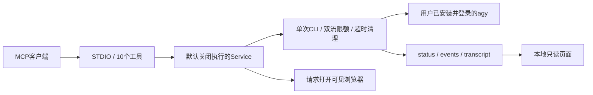

# 设计与改进范围

## 模块职责

- `config.py`：显式环境配置、执行门禁、超时限额与最小CLI环境。
- `service.py`：一次调用映射一个进程；结果验收；单个活动任务；取消所有权。
- `runtime.py`：并发读stdout/stderr、增量UTF-8解码、严格NDJSON、公开事件过滤、心跳与有限清理。
- `history.py`：只从配置的产物目录读取，验证run_id与链接边界。
- `monitor.py`：同一MCP进程内的loopback只读HTTP线程，随机端口，不需要全局helper/PID管理。
- `server.py`：SDK注册工具与生命周期，stdout只用于MCP协议。
- `static/index.html`：独立历史/对话滚动、真实与模拟分类、公开回复与可折叠事件。

## 相对最初PAL适配的变化

1. 从完整PAL和多提供方依赖中提取，只依赖MCP SDK与标准库。
2. 移除机器专用绝对路径、发行版、用户名、登录HOME、全局配置写入及旧安装脚本。
3. 窗口、记录与运行器共享同一次请求，界面展示不消耗额外模型调用。
4. 原communicate全量等待改为读取时双流限额；超时覆盖管道寿命。
5. 失败/取消都记录终态；同实例拥有的任务才允许取消。
6. 移除与plan冲突的disable-slash-commands组合；仍不夸大权限保证。
7. 监控HTTP是只读组件；MCP执行面与页面执行面没有混用。

## 刻意保留的限制

无远端会话自动续聊、文件上传、图像输入、多代理自动讨论、后台队列、并发付费请求、OAuth代理或公网托管。
该版本的“对话记录”指每次输入与输出的可见记录，不是假装维持同一远端模型会话。

## 0.2 整理结果

保留现有职责边界，不增加通用任务框架或多模型层。改善集中在实际热点：

- 关闭服务先设置关闭标记，拒绝新任务；进程创建后的日志失败也进入清理路径。
- 清理使用独立且受 shield 保护的任务，重复取消不能中断本次子进程回收。
- 每个公开事件仍追加保存，流式完整状态快照合并为最多每秒10次；终态立即落盘。
- 历史列表按生成的 UTC run ID 倒序读取最近记录，缓存文件签名和轻量摘要；缓存访问串行化。
- 完整状态单次读取上限5 MiB；事件只读末尾256 KiB内最近100条完整记录。损坏记录跳过。
- 页面轮询摘要，选中记录变化时加载详情；事件展开后才读取。过滤后无记录会清空旧详情。

接口取舍：`agy_history` 返回摘要以减少 MCP 上下文及页面流量；`agy_status` 保留完整详情。磁盘历史不自动删除，长期使用应由操作方管理保留期。

本轮通过本项目 MCP 请求一次 agy 审阅，采纳清理与历史加载建议；未采用无必要的运行锁或额外框架。实现结论以回归测试为依据。

## 0.3 协作层

`discussions.py` 管理本地目标、两方职责、消息引用、决定、次数及有界上下文；`Service.discussion_turn` 只组合一次原有调用并登记来源。已有运行器保持单次调用语义，不持有远端会话。新增5个协作MCP工具和两条只读HTTP路由，页面分单次历史与协作时间线。

先保存尝试再启动调用，因此崩溃不会偷偷退回额度。调用在CLI启动前关联任务；成功、失败、超时、取消由原运行器记录，显式恢复只接受真实终态。上下文来源和截断范围作为每轮记录保存。

## 0.4 对等话轮

新任务使用peer-v1：允许模型先开题，instruction可省略，双方共享提问、质疑和修正的权利。旧lead/reviewer来源键保留兼容，但不再规定谁只能审阅。明确回应引用用于维护本地待答清单；归档保留未解决问题，不推断另一方同意。

模型输出允许一个公开发言、一个追问和回应编号；兼容整个回复的JSON代码围栏及一层JSON字符串转义，仍使用严格JSON解析。原始CLI回复不改写，恢复可从已成功的原始运行重新提取结构，不再发起调用。上下文待答问题最多4个，未带入编号明示。
